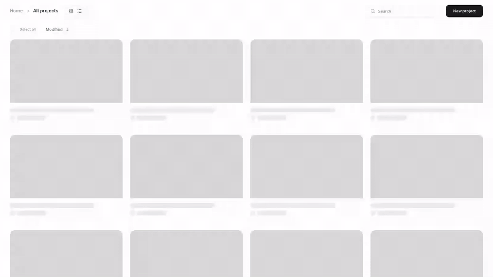

# opencut-mcp

MCP (Model Context Protocol) server for [OpenCut classic](https://github.com/opencut-app/opencut-classic).
Lets an LLM agent (Claude Code, Cline, etc.) drive the video editor via `window.__editor`
in a Playwright-controlled browser.

**Status**: PoC for kenimoto.dev article series. Requires the `kenimo49/opencut-classic`
fork with the [Phase 1 exposure patch](https://github.com/kenimo49/opencut-classic/commit/eca73042).

## Demo

`scripts/demo.ts` runs a full end-to-end sequence: create a project, upload a video
+ audio file, place both on the timeline via auto-placement, split the video at 5s.
The Playwright screencast below is that run recorded verbatim.

<video src="https://github.com/kenimo49/opencut-mcp/raw/main/docs/demo.mp4" controls poster="docs/demo-poster.png" width="800"></video>

<!-- Fallback for Markdown viewers that ignore <video>. GitHub renders <video> above; other viewers show the GIF. -->


## Tools

| tool | description |
|------|-------------|
| `opencut_get_state` | Timeline snapshot (tracks, elements, assets). |
| `opencut_add_track` | ⚠ empty tracks are pruned by the reactor — prefer omitting `trackId` on `insert_clip`. |
| `opencut_add_media` | Upload local file as MediaAsset. |
| `opencut_insert_clip` | Add element referencing MediaAsset. `mode: "auto"` when `trackId` omitted. |
| `opencut_split_at` | Split element(s) at a time (seconds). |
| `opencut_move` / `opencut_trim` / `opencut_delete` | direct pass-through to TimelineManager. |
| `opencut_undo` / `opencut_redo` | CommandManager history. |
| `opencut_export` | RendererManager.exportProject. |
| `opencut_screenshot` | debug: screenshot the editor viewport. |

## Running

```sh
# 1. Start classic (docker + bun dev:web on 3000). See kenimo49/opencut-classic README.
# 2. Install this MCP:
bun install
bunx tsx src/index.ts   # stdio transport

# 3. Or the integration demo:
bunx tsx scripts/demo.ts
```

Env:
- `OPENCUT_BASE_URL` — default `http://localhost:3000`
- `OPENCUT_HEADLESS` — `false` to see the browser (WSLg / X11 required)
- `OPENCUT_VIDEO_DIR` — set to record a webm screencast of the browser
- `OPENCUT_DEMO_PACE=slow` — triples inter-step pauses in `scripts/demo.ts`

## Notes discovered during PoC

1. **Empty tracks are pruned** every command via `CommandManager` reactor
   (`editor/index.ts:playback.bindTimelineScope`). Two-step `addTrack` + `insertElement`
   loses the track before the second call. Prefer `insertElement` with
   `placement: { mode: "auto", trackType }` — the command creates the track on demand
   and it survives because it has an element.
2. **MediaTime is integer ticks**, not seconds. `TICKS_PER_SECOND` is 120,000 at runtime.
   Convert via `window.__opencut.mediaTimeFromSeconds({ seconds })` (Phase 1.1 exposure).
3. **AudioElement discriminated union** — uploads must carry `sourceType: "upload"`
   in addition to `mediaId`.
4. **Editor page is `/editor/[project_id]`**. Creating a project via the /projects UI
   is the boot path used by this server.

MIT.
